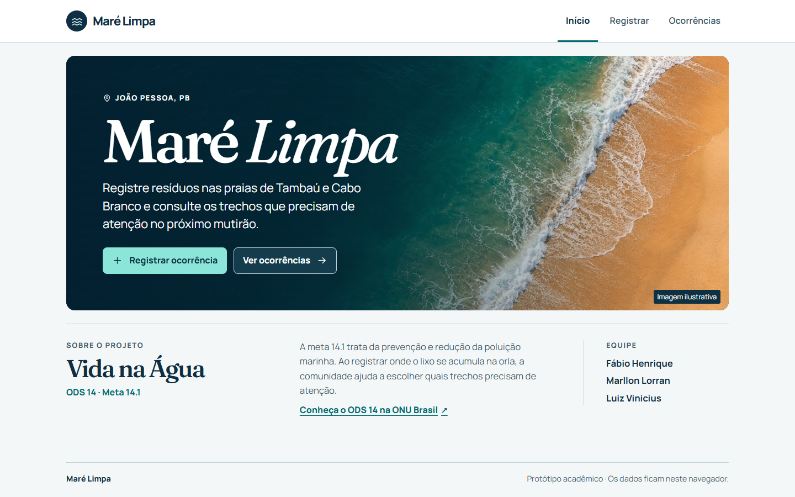

# Maré Limpa

**Registro e acompanhamento de resíduos nas praias de Tambaú e Cabo Branco, em João Pessoa (PB).**

[Abrir o aplicativo](https://eumarllonlran0.github.io/mare-limpa/) · [Roteiro de apresentação](#roteiro-de-apresentação) · [Execução local](#execução-local)



## Objetivo do projeto

O Maré Limpa é um protótipo acadêmico que organiza relatos de resíduos por praia, trecho e categoria. A consulta ajuda a identificar pontos que merecem atenção no planejamento de um mutirão e permite registrar quando o resíduo foi recolhido.

O projeto se relaciona com o **ODS 14 — Vida na Água**, especialmente a **meta 14.1**, voltada à prevenção e à redução da poluição marinha. [Consultar a meta na ONU Brasil](https://brasil.un.org/pt-br/sdgs/14)

## Como funciona

| Etapa | O que a pessoa pode fazer |
| --- | --- |
| **Registrar** | Selecionar a praia e a categoria do resíduo, informar um ponto de referência e acrescentar uma descrição opcional. |
| **Consultar** | Combinar filtros de praia, categoria e status com uma busca por trecho. |
| **Acompanhar** | Marcar uma ocorrência como **Recolhida** e verificar se a alteração foi salva após recarregar a página. |

Na primeira abertura, o app apresenta quatro ocorrências identificadas como **Dados simulados**. Cada navegador guarda seus próprios registros e atualizações no `localStorage`, vinculados ao endereço usado para acessar o app.

## Roteiro de apresentação

1. Abra **Início** e apresente a proposta do projeto e sua relação com a meta 14.1.
2. Em **Registrar ocorrência**, tente salvar o formulário vazio para mostrar as mensagens de validação e o foco no primeiro campo obrigatório.
3. Registre uma ocorrência de **Plástico** em **Cabo Branco**, no trecho **Acesso à areia perto da ciclovia**. Salve e mostre a confirmação e o status **Registrada**.
4. Em **Ocorrências**, filtre por **Cabo Branco** e **Plástico** e digite **ciclovia** na busca. No celular, toque em **Filtros** para abrir os seletores.
5. Clique em **Marcar como recolhida**. Recarregue a página e reaplique os filtros para confirmar que a ocorrência continua com o status **Recolhida**.

## Capturas de tela

| Tela | Celular (390 px) | Desktop (1440 px) |
| --- | --- | --- |
| Início | [Ver captura](capturas/inicio-celular.png) | [Ver captura](capturas/inicio-desktop.png) |
| Ocorrências | [Ver captura](capturas/ocorrencias-celular.png) | [Ver captura](capturas/ocorrencias-desktop.png) |

## Execução local

O aplicativo usa HTML, CSS e JavaScript puro. Imagens e fontes acompanham o projeto, o que permite a demonstração sem internet.

1. Clone o repositório e entre na pasta.

   ```sh
   git clone https://github.com/eumarllonlran0/mare-limpa.git
   cd mare-limpa
   ```

2. Com o Python 3 instalado, inicie o servidor local.

   ```sh
   python -m http.server 8000 --bind 127.0.0.1
   ```

3. Abra [http://127.0.0.1:8000](http://127.0.0.1:8000) no navegador. Use o mesmo endereço e perfil para consultar os relatos que já salvou. Encerre o servidor com **Ctrl+C**.

Também é possível abrir `index.html` diretamente em navegadores que permitem armazenamento local para arquivos.

## Equipe

**Fábio Henrique**, **Marllon Lorran** e **Luiz Vinicius**.

## Créditos

A [imagem de abertura](litoral.jpg) é uma ilustração gerada com ImageGen a partir de uma descrição inspirada no litoral de João Pessoa. As licenças das fontes estão na [pasta `fonts`](fonts/).

<details>
<summary>Descrição usada para gerar a imagem</summary>

> Fotografia aérea editorial e fotorrealista de um litoral, para a faixa de destaque de largura total de um aplicativo web brasileiro de limpeza de praias. Formato paisagem 3:2. Nos dois terços da esquerda, mar azul-petróleo escuro com uma textura natural bem sutil na superfície e sem ondas quebrando, para receber um texto branco por cima. No canto direito, uma faixa inclinada de areia dourada e quente, cercada pela água rasa turquesa e pela espuma branca rendada de uma onda, na diagonal do canto superior direito até o meio da parte inferior direita. Vista de cima, de drone. Luz natural e quente do dia, cores realistas e intensas do mar, textura fina e verossímil. Inspirada no litoral de João Pessoa, sem mostrar pontos de referência reconhecíveis. Sem pessoas, sem textos, sem ilustração, sem gráficos e sem marca-d'água.

</details>
